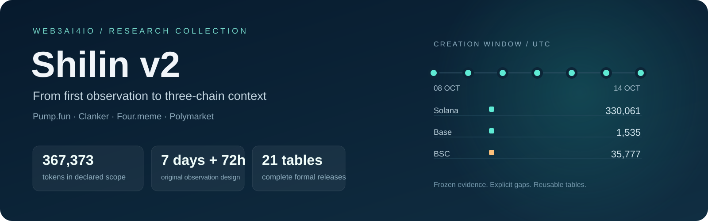
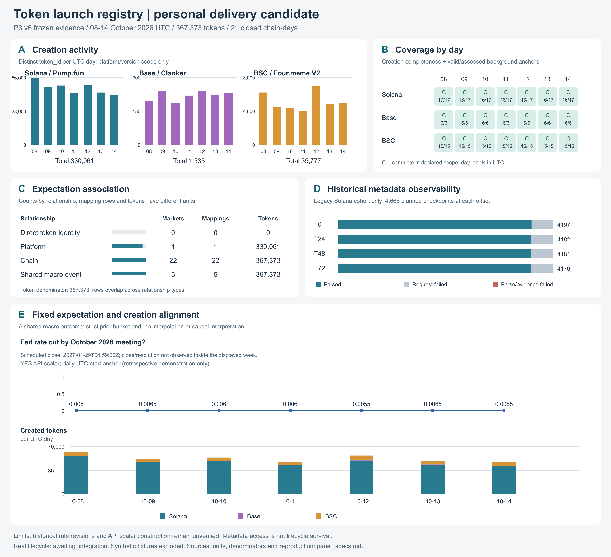

# Shilin v2



**Seven-day creation records, 72-hour metadata observations, and three-chain market context.**

[中文指南](docs/README.zh-CN.md) · [Data catalogue](docs/TABLES.md) · [Reproduce](docs/REPRODUCE.md) · [Curation](docs/CURATION.md) · [Full evidence download](https://github.com/Global-Nomad-Nexus/Web3AI4IO-SD-Template/releases/tag/shilin-v2-20261029)

This collection brings together Shilin's original Pump.fun cohort and the later Registry / Polymarket experiment. It includes every row of both released datasets, their acquisition and processing code, frozen protocols, tests, field dictionaries, final validation reports, and figure sources. The shared creation window is **8–14 October 2026 UTC**, represented as `[2026-10-08, 2026-10-15)`.

| Collection | Included data | Evidence status |
|---|---|---|
| Original 7 days + 72 hours | **4,668** creation events · **18,672** planned checkpoints · **133,888** field observations · **6** tables | Collection finished; original validation remains `INCOMPLETE` with four unresolved transactions |
| Three-chain Registry, P3 v6 | **367,373** tokens · **21/21** chain-days · **15** tables | **35/35** checks passed for declared platform scope |
| Polymarket alignment | **6,156,902** assessments · **5,856,212** valid · **28** context mappings | Historical scalar demonstration; **0** direct token-identity mappings |
| P4 interface and gallery | Five panels, interface fixtures, complete frozen input capsule | Original independent package acceptance **55/55** passed; real lifecycle integration pending |

## Explore the evidence



The gallery shows daily creation counts, chain-day coverage, mapping scope, metadata terminal states, and daily market-context alignment. [Panel definitions and source CSVs](source/2026-10-27/registry_polymarket/p4/figures/panel_specs.md) document the denominator and limitations of each view. Solana contributes 330,061 tokens, Base 1,535, and BSC 35,777 within the pinned platform scope.

## Use the data

From the repository root:

```bash
python3 pilots/shilin_v2/tools/data.py list
python3 pilots/shilin_v2/tools/data.py verify --deep
python3 pilots/shilin_v2/tools/data.py restore --output outputs/shilin_v2
```

The tools need only Python's standard library. Data are stored as gzip CSV shards containing complete records and a header; restoration verifies the original full-file SHA-256. **All 21 logical tables are present without sampling.** The restored package also passed a fresh **55-check independent offline rebuild**; see the [verification receipt](metadata/independent_acceptance.json). `registry` and `creation_events` share one physical copy because their original bytes are identical. Both original filenames are recreated on restoration. See the [full table catalogue](docs/TABLES.md) for grains, row counts and fields.

For raw/normalized evidence and the locked environment needed to repeat the complete independent rebuild, obtain the separate **`inputs.tar.gz`** [Release asset](https://github.com/Global-Nomad-Nexus/Web3AI4IO-SD-Template/releases/tag/shilin-v2-20261029). The capsule is optional for table analysis. [Reproduction instructions](docs/REPRODUCE.md) explain download verification, exact P4 package restoration, platform requirements, and offline acceptance.

## Project map

```text
shilin_v2/
├── data/                 Complete legacy six tables + P3 v6 fifteen tables
├── metadata/             SHA-256 manifests, row counts, dictionary, checks
├── source/
│   ├── 1021/             Original seven-day / 72-hour collector and protocol
│   └── 2026-10-27/       P0–P4 acquisition, decoding, processing, tests, figures
├── reproduction/         Exact sealed P4 code, metadata, and acceptance skeleton
├── tools/                Offline integrity checks and byte-faithful restoration
└── docs/                 Data catalogue, curation, reproduction, Chinese guide
```

The source snapshot keeps original relative paths for frozen code and provenance. Begin with this README; some archived READMEs describe the original local directory and require restored data or the evidence capsule. Caches, interrupted process logs, superseded derived outputs, and duplicate delivery packages are excluded. [Selection details](docs/CURATION.md) and the [source inventory](metadata/source_inventory.json) make that curation reviewable.

## Interpretation and reuse

The original metadata cohort is a limited observed cohort, not a complete weekly on-chain denominator. The later backfill preserves historical observation gaps. `observed`, `request_failed`, and `parse_failed` remain distinct; no unavailable metadata is interpreted as death.

The Registry covers pinned Pump.fun `create/create_v2`, six Clanker factories and Four.meme V2. It is not a census of every issuance mechanism. Polymarket mappings connect chain, platform or shared economic context; historical rule revisions and API scalar construction remain unverified, with `retrospective_demonstration_only` preserved. Real lifecycle integration is `awaiting_integration` and the common cutoff is unset.

Historical P4 documents describe its original local-review artifact. This GitHub publication has the separate identifier **`shilin-v2-20261029`**. Third-party rights review remains incomplete; the repository code license does not license external data. Read [data rights and attribution](DATA_RIGHTS.md) and the frozen source register before reuse. No DOI, official metadata validation, complete lifecycle release, or article acceptance is claimed.
