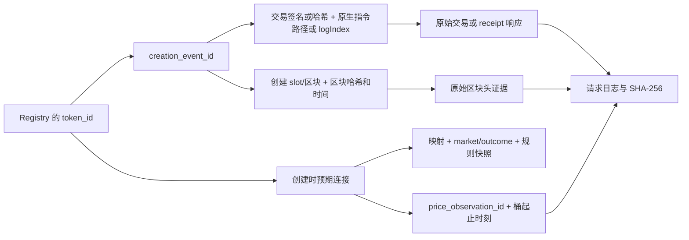

# P0—P2 工作内容、实验过程与数据来源详记

记录日期：2026-10-27（北京时间）。

## 阅读说明

本文根据实施方案、执行代码、查询账本、原始响应、阶段验收报告和离线复现记录，整理我们从 P0 到 P2 实际完成的工作。它既记录成功路径，也记录失败探测、调整原因和仍未解决的问题。

**截至 P2，已完成声明平台版本范围内的三链共同整日试点，得到 61,916 个不同代币。旧七日队列仍作为独立历史数据保存。**

| 项目 | 本纪要的口径 |
|---|---|
| 原始任务依据 | [Shilin 任务解读与实施建议][plan_advice]、[执行路径][plan_path] |
| 材料范围 | 本地旧七日包，以及 `registry_polymarket` 内的 P0/P1 与 P2 成果 |
| 整理方式 | 沿用 academic-research-suite 的证据对应与可复现记录原则；根据存档结果整理，区分事实、方法判断和未知项 |
| 实验类型 | 数据审计、接口能力探测、历史创建枚举、原生解码、时间连接、证据交叉核验、离线复现 |
| 验证依据 | 已保存的机器可读验收与复现结果，以及本次对文件、计数和集合关系的核对 |
| 尚未开展的研究 | 正式扩展窗口、整周完整性重建、真实生命周期联合分析；本轮没有因果估计或预测模型训练 |

下文 E01—E24 是为本纪要新增的实验索引编号；原始请求仍以账本中的 `request_id`、交易签名、区块位置和响应哈希定位。

## 一、先看三个阶段分别完成了什么

| 阶段 | 要解决的问题 | 实际工作 | 阶段结束时的结论 |
|---|---|---|---|
| P0 | 本地旧数据是否存在、能否追溯、身份和异常是否清楚 | 找到旧七日六表、协议与采集代码；复用离线审计；检查哈希；建立 Registry、身份 crosswalk、覆盖表、字典和接口草案 | 可信旧数据基础已建立；4,668 是旧纳入队列数，整周创建总体仍未知 |
| P1 | 三链历史数据和 Polymarket 历史预期是否有真实可行路径 | 有界探测三链 RPC；搜索真实市场；取得规则、原生 outcome ID 和历史价格；完成一条真实 as-of 连接及旧队列连接 | 有限可行性调查完成；真实历史时间连接展示通过；当时 Base/BSC 完整创建来源仍待解决 |
| P2 | 能否交出同一完整 UTC 日、三链真实创建到历史预期的完整链路 | 冻结窗口与版本；完成 Base、BSC 整日创建；经多次公开来源切换补齐 Solana；交叉核验、左连接、复现和验收 | 61,916 个不同代币；33 项验收全部通过，10 项隔离测试通过，两个离线重建结果逐字节一致 |

两个阶段报告的状态是各自结束时的快照。[P0/P1 报告][p01_report]中的“P2 尚未开始”“Base/BSC 来源未解决”描述的是当时状态；P2 后续结果以 [P2 报告][p2_report]和[最终验收 JSON][p2_validation]为准。

### 1.1 三个时间范围要分别理解

| 范围 | UTC 区间 | 含义 |
|---|---|---|
| 旧七日创建窗口 | `[2026-10-08T00:00:00Z, 2026-10-15T00:00:00Z)` | 旧包中 4,668 条纳入记录所属的创建窗口 |
| P1 取得的价格历史 | 桶起点从 2026-10-06 00:00 至 2026-10-14 23:30，每桶 1,800 秒 | 包含旧周之前两天，用于日初和创建时刻的向前查找 |
| P2 共同创建窗口 | `[2026-10-08T00:00:00Z, 2026-10-09T00:00:00Z)` | 新试点的完整 UTC 日；对应北京时间 10 月 8 日 08:00 至 10 月 9 日 08:00 |

2026-10-27 是本轮审计、历史补录和整理的执行日期。链上创建时刻、历史价格信息时刻和本次取得证据的时刻分别保存，不能把 10 月 27 日的取证时间写成历史首次观察时间。

## 二、工作推进过程与关键转折

以下有钟点的节点取自落盘记录，并统一换算为北京时间；它们不是用户消息的发送时间。没有单独时间戳的决定按工作先后描述，不补造精确时刻。

| 执行节点（2026-10-27，北京时间） | 发生了什么 | 记录依据 |
|---|---|---|
| 15:09 起 | P0/P1 的公开来源请求开始形成记录，随后交错开展来源探测和市场历史获取 | [P0/P1 资源记录][p01_resources] |
| 15:23:58—15:23:59 | P0/P1 离线复现与阶段交付完成：29 项实际数据检查中 error 级失败为 0，8 项测试通过 | [P0/P1 复现][p01_replay]、[运行回执][p01_run] |
| 16:43:53 起 | P2 的独立请求日志开始记录来源与边界探测 | [P2 资源记录][p2_resources] |
| 16:48:34 | 冻结 P2 的 10 月 8 日完整 UTC 日及创建范围 | [P2 协议][p2_protocol] |
| P2 前半程 | SQD 可取得真实数据，但 Solana 大量出现 529；依次调整分块、续传、最终性接口及调度，保存部分结果 | [Solana 查询账本][sol_archive_ledger]、[协议修订记录][p2_protocol] |
| 18:35—18:38 左右 | 官方 RPC 的必需账户索引读取推进；最终账本保留 65 页完整索引 | [索引分页表][sol_index_pages]、[索引回执][sol_index_receipt] |
| 18:44—19:10 | BSC 从抽查升级到全部创建的原生 receipt 与区块头核验 | [BSC 全量核验回执][bsc_qa_receipt] |
| 扩展公开来源后 | Vibe Station 返回可用的完整历史交易；CryptoHouse 能按指定 slot 批量返回区块头，成为两个关键补齐来源 | [来源切换决定][source_decisions] |
| 19:13:56 | Vibe 全部 595 个交易页取回，59,404 笔候选与官方索引完全一致 | [Vibe 回执][vibe_receipt] |
| 19:17:31 | 50,322 个候选 slot 的区块头全部有来源，时间冲突为 0 | [区块头回执][headers_receipt] |
| 19:21:23 | 最终完整队列的 27 项补充原生回放检查全部通过 | [原生 QA 回执][native_qa_receipt] |
| 最终验收过程 | 发现 P0/P1 与 P2 同名复现模块的导入路径冲突；修复 P2 模块查找顺序，重新锁定代码和复现哈希 | [P2 I/O 代码][p2_io]、[复现日志][p2_replay_log] |
| 19:31:06—19:32:33 | 使用修复后的代码，从固定原始输入重复重建两次，耗时 87.142 秒，网络请求为 0，CSV 字节一致 | [最终离线复现][p2_replay] |
| 19:32:49 | 33 项最终验收全部通过，error 与 pending gate 均为 0 | [最终检查表][p2_checks] |
| 19:33:40 | 更新 P2 完成状态、阶段入口和文件清单 | [P2 最终状态][p2_status] |

## 三、P0：找到并固定可信的旧数据基础

### 3.1 本地找到了哪些数据、代码和记录

旧包位于 [scientific-data-essential][legacy_root]。主要内容如下：

| 材料 | 位置或入口 | 本轮用途 |
|---|---|---|
| 七日发布六表 | [7day-72h-20261008-release][legacy_release] | 检查旧纳入队列、请求、响应摘要、字段观察和覆盖终态 |
| 采集协议与运行记录 | [7day-72h-20261008-protocol][legacy_protocol] | 查看窗口、接口选择、输入清单、数据血缘、进度和运行状态 |
| 历史采集代码 | [code-7day-72h][legacy_code]，包括 `run_mvp.py` 和 `mvp/acquire_chain.py` 等 | 理解创建解码、URI 过滤、请求路由与随访安排 |
| 既有离线审计 | [rq_feasibility_audit.py][legacy_audit_code] | 复用已有六表审计能力，将本轮输出写入新工作区 |
| 旧审计参考结果 | 旧包 `analysis/` 中的结果；本轮复核输出见 [legacy_rq_audit.json][legacy_rq] | 对照聚合计数、真实完成时间和字段变化结果 |

本地保存了六表和协议记录，但旧七日精简包未包含完整历史响应正文，也未保留原 `request_attempts.jsonl`；已保留相应 CSV。因而可以重算表内关系、状态和聚合，无法仅凭旧包对所有历史 HTTP 正文重新计算哈希或重放解析。

### 3.2 E01—E02：基线计数与字节完整性审计

通过 `p0_baseline.py` 复用旧审计，检查行数、旧事件键唯一性、窗口约束、外键及参考聚合，并对六表和协议材料记录 SHA-256。

| 旧表 | 行数 | 一行代表什么 |
|---|---:|---|
| `launch_events.csv` | 4,668 | 一条旧纳入创建事件 |
| `observation_plan.csv` | 18,672 | 一个事件的一个计划检查点，即 4,668 × T0/T24/T48/T72 |
| `request_attempts.csv` | 60,779 | 一次请求/路由尝试记录，包含策略拒绝等非实际网络执行记录 |
| `response_snapshots.csv` | 16,744 | 一条保留下来的响应快照/解析记录 |
| `field_observations.csv` | 133,888 | 一次合格 JSON 中一个抽取字段的状态和值摘要，合计八个字段 |
| `coverage_ledger.csv` | 18,672 | 一个事件—检查点的终态及覆盖记录 |

复核结果：4,668 个旧事件键唯一，crosswalk 完整，窗口外事件为 0；creator 地址数为 2,993。这里统计的是链上地址，不是经过身份识别的自然人数。[基线审计][baseline]记录了 18 个参考输入，P2 结束后的[再次哈希核对][legacy_unchanged]确认这 18 个输入均未改变。

60,779 条尝试记录也不能直接叫作 60,779 次实际 HTTP 请求。例如其中 12,864 条属于 `route_refused_policy`，审计记录显示这些行没有实际请求起止时间。

### 3.3 E02 的补充结果：旧元数据到底观察到了什么

旧审计按真实完成时间计算“创建后 24 小时内可用 JSON”，结果为：

| 24 小时口径分组 | 代币数 |
|---|---:|
| 在创建后 24 小时内取得合格 JSON | 4,197 |
| 已有已完成的网络尝试，但未取得合格 JSON | 470 |
| 状态未知 | 1 |
| 合计 | 4,668 |

这组“24 小时内”结果与名为 `T24` 的检查点统计不同：前者判断实际证据是否在截止时刻之前完成，后者是计划检查点标签。不能直接用标签代替真实完成时间。

旧记录中的 declared URI 主机及当时的可用性概况如下；这些是对历史表的审计，不代表本轮重新访问了这些元数据主机。

| URI 主机分组 | 旧事件数 | 24 小时内合格 JSON | 说明 |
|---|---:|---:|---|
| `ipfs.io` | 3,216 | 2,803 | 是原声明 URI 主机；历史路由中包含 Pinata 网关路径 |
| `metadata.j7tracker.io` | 728 | 728 | 按旧请求与快照关系核对 |
| `meta.uxento.io` | 182 | 182 | 同上 |
| `m.rapidlaunch.io` | 96 | 96 | 同上 |
| `pump.mypinata.cloud` | 82 | 82 | 原声明主机分组 |
| 其他主机 | 363 | 306 | 另有 56 个已尝试未取得 JSON、1 个未知 |
| 无主机 | 1 | 0 | 未取得 JSON |

纵向比较中，至少有两次成功 JSON 的代币为 4,185 个。21 个代币的响应正文摘要曾变化，但八个抽取字段的状态/值摘要在可比较记录中均未检测到变化。两者测量对象不同：正文哈希变化可以来自未抽取内容或序列化等差异；当前证据不足以把这 21 个变化归为某种具体内容修改，也不能推断完整元数据始终不变。

八个字段是 `name`、`symbol`、`description`、`image`、`website`、`twitter`、`telegram`、`createdOn`。字段存在、非空、类型与 URL 字符串形式分别判断；URL 语法合格不代表所有权、网页可达性或真实身份已验证。详见[旧 RQ 审计结果][legacy_rq]。

### 3.4 E03：把旧身份转换为可连接的最小模型

建立以下派生表，各保留 4,668 条旧身份：

| 输出 | 用途 |
|---|---|
| [creation_events.csv][p0_events] | 保留原生创建证据和旧纳入事件 |
| [registry.csv][p0_registry] | 每个链限定代币一行，作为后续左连接母表 |
| [token_id_crosswalk.csv][crosswalk] | 从旧 event key 找回新的 token_id / creation_event_id |
| [metadata_coverage.csv][metadata_coverage] | 保留 18,672 个检查点的计划、真实时间、原终态和缺失原因 |

`token_id` 使用链名加地址：Solana 地址保留大小写，EVM 地址规范为小写。相同地址字符串出现在不同链上仍是不同身份。旧记录标记为 `legacy_import`，并保留其来源和导入操作时间。

创建时间、首次解码时间和取回证据时间分别建模。T0 依据原采集器的首次解码安排，T24/T48/T72 依据创建区块时间加偏移安排；新补录记录没有历史观察证据时，不继承这些已完成标签。

### 3.5 异常定位：保留了什么，解决了什么

| 异常或限制 | 本轮处置 | 当前状态 |
|---|---|---|
| 4 个成功检查点缺所选快照 | 定位到同一个旧 event key 的 T0/T24/T48/T72，保留对应 request_id | 身份已定位，历史正文仍缺失 |
| 4 笔链上交易未取回 | 保留为一组已知 4 笔；旧材料缺具体签名 | 仍需原采集集群日志追查，不编造逐笔身份 |
| 旧七日创建总体未知 | 将 4,668 明确记为旧纳入队列 | 整周独立枚举留到 P3B |
| 旧解码存在空 URI 排除规则 | 记录可能造成纳入偏差；P2 取消此门槛 | 旧周因此遗漏多少仍未知 |
| 历史 HTTP 正文不在精简包 | 保留可用表、摘要、协议与缺失说明 | 不能宣称已恢复所有历史正文 |
| 旧登记的 ABI/IDL 历史有效边界未知 | 保留官方修订与布局哈希，把边界标为未知 | P2 补固定窗口的适配证据，完整升级史仍未证明 |

旧覆盖账本有 16,736 个 `observed`、1,924 个 `request_failed`、12 个 `parse_failed`。保存的快照中有 16,736 个 `json_ok`、8 个 `parse_error`，再加上上述 4 个缺所选快照的检查点，说明不能把账本里的 12 个 `parse_failed` 全部解释为已确认的 JSON 格式错误。详细定位见[异常表][unresolved]。

### 3.6 E04：协议、字典、接口草案与持续写作

P0 同时形成了：

- 创建窗口、正式窗口与生命周期 cutoff 分层的协议；试点候选按固定顺序保存。
- 最小 schema、逐列字典和旧六表字典，明确主外键、时间单位和缺失状态。
- [私人接口合同草案][interface]：提供 token_id、chain_key、platform_id、创建时间和证据引用；预留生态事件及来源覆盖字段。
- creator 地址集中度 D 面板[预览][panel_d]及其源表。
- Methods、Data Records、Data Overview、Technical Validation、Usage Notes 的[阶段性写作记录][p01_manuscript]。

接口草案的状态为 `unconfirmed_by_claire`，共同 cutoff 保持空值，真实生命周期状态为 `awaiting_integration`。这些是个人阶段的结构准备，没有当作已接入真实生态结果。

## 四、P1：验证公开来源与真实历史预期连接

### 4.1 E05—E06：三链历史能力探测

按起点、中点、末点等有限位置，测试历史区块、交易或 receipt、工厂日志、分页和时间边界能力。主要使用：

| 链/平台 | 当时测试的公开来源 | 得到了什么 | 当时不能据此证明什么 |
|---|---|---|---|
| Solana / Pump.fun | 官方 `api.mainnet-beta.solana.com`；PublicNode 也做探测 | 官方来源取得三处历史块/交易，程序历史分页可以推进；PublicNode 有连接失败记录 | 不能由少数交易和可翻页直接证明整周全量创建已取得 |
| Base / Clanker | `mainnet.base.org`、`base-rpc.publicnode.com` | 取得有限历史区块和 receipt；备用来源三段 20 块日志返回空数组 | 小段空数组不等于平台没有创建；主来源还出现 429 |
| BSC / Four.meme | `bsc-dataseed.bnbchain.org`、PublicNode、1RPC | 有限历史块和 receipt 可读；日志方法出现 limit、403 或历史 header not found | 不能把日志方法拒绝解释为零发行 |

BNB 当时参考的官方文档说明主公共 RPC 禁用 `eth_getLogs`。在有界备用探测之后，P1 将 BSC 历史工厂日志路径记为未解决。[来源能力表][p01_capability]、[三链可行性表][p01_threechains]和[查询账本][p01_chain_ledger]保留了这些结果。

P1 结束时，三链都只是“部分技术可行”；后续 P2 才继续解决完整窗口来源。这一阶段没有把几个成功样例包装成整日或整周总体。

### 4.2 E07：Polymarket 候选搜索

通过 Gamma 公开搜索，分别查询 active 与 closed 状态，保存页码、参数、返回 ID、`hasMore` 和停止原因。固定关键词为：

| 主题 | 搜索词 |
|---|---|
| 宏观 | `Fed` |
| Solana | `Solana October 2026` |
| BNB | `BNB October` |
| Pump.fun | `Pump.fun` |
| Base | `Base token` |

每个状态最多两页，设置 `limit_per_type=3`；实际搜索 17 次，得到 270 个去重候选 market。达到页上限且服务端仍有更多结果的情况明确记录为未穷尽。270 不是 Polymarket 全目录，也不是 Pump.fun 题目的完整市场集合。

选历史展示市场时，先固定可解释的 Fed 25 bps 合约，其余 BNB、Base、Solana 主题在语义与时间重叠合格候选中按最小数值 market ID 选择；选择发生在取得价格历史之前，避免按价格变化方向挑题。见[搜索日志][search_log]、[候选目录][candidate_catalogue]和[采集代码][p1_pm_code]。

### 4.3 E08：规则、outcome ID 与历史价格获取

对四个市场取得规则全文、market/condition 等标识、outcome 标签和 Gamma 返回的原生 asset ID。每个市场保存两个 outcome，因此 `pm_outcomes.csv` 有 8 行；实际价格历史读取的是四个 Yes outcome。

| Market ID | 保存的问题 | 历史点数（含前置期） | 实际桶宽 |
|---|---|---:|---:|
| 2589811 | Will the Fed decrease interest rates by 25 bps after the October 2026 meeting? | 432 | 1,800 秒 |
| 5171321 | Will BNB reach $1,200 in October? | 432 | 1,800 秒 |
| 690693 | Will Base launch a token by December 31, 2026? | 432 | 1,800 秒 |
| 5170795 | Will Solana reach $200 in October? | 432 | 1,800 秒 |
| 合计 | 四个 Yes outcome | 1,728 | 每 30 分钟一个桶 |

价格来自当时实际可用的 Data API v2 `prices-history`，Fed 历史通过两页取完。每个 outcome 在旧七日内有 336 个点，前置两天另有 96 个点。没有将 CLOB 历史序列与 Data API 序列拼在一起。

Fed Yes 的原生 asset ID 为：

```text
33268510350568915228897273528353467773422190590579607471427765079749830445947
```

该 ID 按精确字符串保存，避免表格软件浮点转换损坏。它的来源字段为 Gamma `clobTokenIds`；没有仅凭 ID 的外观推断所有底层合约身份。

规则快照是本次取回的定义快照，历史规则版本档案没有取得。价格标量的具体构造也未被来源明确解释为成交价或 midpoint。因此保存为历史市场预期代理，并保留回溯展示限制。数据入口见[市场定义表][p1_markets]、[outcome 表][p1_outcomes]、[历史价格表][p1_prices]和[可行性记录][pm_feasibility]。

### 4.4 E09：确认桶时间含义，并实现严格 as-of 连接

当时保存的官方 OpenAPI 明确：聚合 `timestamp` 是桶起点，桶宽由 `resolution_seconds` 给出。于是信息结束时刻为：

```text
information_end = source_timestamp + resolution_seconds
```

创建时连接必须同时满足：

1. `information_end < created_at`，严格小于，等于时排除。
2. `created_at - information_end <= 24 小时`，并另外评估 12/48 小时阈值。
3. 市场开市及预定有效区间适用。
4. 不将当前价格、结算结果或含义未分清的零分辨率 tick 当作历史预期。

真实样例：代币 `6a4LJXscVdTwr2pUwApZmuwfCACD6gsfuF9s443cpump` 创建于 **2026-10-08T00:00:05Z**，连接到 Fed Yes 的 **2026-10-07T23:30:00Z—2026-10-08T00:00:00Z** 桶，值为 **0.005**。桶结束比创建早 5 秒，符合严格前信息条件。[样例 JSON][asof_example]保留了对应身份和价格引用。

关系类型使用 `shared_economic_event`。同一 FOMC 背景可以适用于三链，但它不是对每个普通新币上市、交易或毕业的直接预测。

### 4.5 P1 的实际连接与验证结果

| 指标 | P1 结果 | 解释 |
|---|---:|---|
| 旧 Registry 不同 token_id | 4,668 | 保留旧纳入母表 |
| 连接后不同 token_id | 4,668 | 左连接没有因缺直接市场而删币 |
| 有效共享宏观创建锚点 | 4,668 / 4,668 | 只表示该固定宏观背景的时间连接可用 |
| 已验证直接身份映射 | 0 / 4,668 | 本轮未建立直接代币身份预测关系 |
| 三链 × 七日背景格可用 | 21 / 21 | 背景数据可用性，与创建完整性分开 |
| 当时背景与完整创建可共同分析的格数 | 0 / 21 | 当时尚未完成三链全窗口创建枚举 |

P0/P1 共保存 29 项实际数据检查：error 级失败为 0，另外保留四类已知限制。8 项隔离测试检查了同秒排除、未结束桶、结算/模糊 tick、陈旧值、精确最大年龄、非法价格和链限定身份。离线重建网络请求为 0，七张核心派生表语义指纹一致；导入/映射操作时钟被排除，因此这一阶段的复现标准是**语义一致**，而不是所有 CSV 字节一致。见[P0/P1 验收][p01_validation]和[复现记录][p01_replay]。

## 五、P2：冻结共同整日与版本范围

### 5.1 E11：固定日期与原生边界

采用预先列出的首选完整 UTC 日 2026-10-08，并于 2026-10-27 16:48:34 北京时间冻结。后续遇到公开来源过载，调整的是读取来源与调度，日期、程序地址、创建定义和价格时间规则保持固定。

边界通过原生 RPC 核验“前一块时间 < 目标时刻 ≤ 边界块时间”。Solana 的 SQD 时间定位曾把日初返回为 slot **454628475**，与真实日初不一致，因此改用官方 RPC 二分与相邻块验证；没有采用该错误定位截掉前半天。

| 链 | 起点（含） | 终点（不含） | 声明原生位置数 |
|---|---:|---:|---:|
| Solana | 454377023 | 454698759 | 321,736 个 slot 位置 |
| Base | 52314127 | 52357327 | 43,200 个区块位置 |
| BSC | 126344214 | 126536085 | 191,871 个区块位置 |

Base 首个入选边界块时间为 00:00:01Z，其前一块为前日 23:59:59Z；这符合半开时间窗口的定位规则。位置数是区块/slot 区间长度，不是代币数，也不表示每个 Solana slot 都产出了区块。证据见[边界表][boundaries]和[原始探测][discovery]。

### 5.2 E12：固定平台、版本与创建判据

Solana 使用程序：

```text
6EF8rrecthR5Dkzon8Nwu78hRvfCKubJ14M5uBEwF6P
create discriminator:    181ec828051c0777
create_v2 discriminator: d6904cec5f8b31b4
```

对照窗口前后两份官方 Pump IDL：`8cda1fa30ea658b20909d8aedf002047119388d2` 与 `2293f9a66c654e9fe82dc5e8f4618538f24bb35f`。验证所用 discriminator、name/symbol/URI 三个字符串、creator 前缀和 mint 账户位置的兼容性；可选尾部字节另存，不强套后来完整尾部布局。

Base 根据固定 Clanker SDK 修订 `4f4d2bbf41c7f10543559dc043c85f443a6d452e` 查询六个工厂：

| 版本 | 工厂地址 | 本日合格创建 |
|---|---|---:|
| v0 | `0x250c9fb2b411b48273f69879007803790a6aea47` | 0 |
| v1 | `0x9b84fce5dcd9a38d2d01d5d72373f6b6b067c3e1` | 0 |
| v2 | `0x732560fa1d1a76350b1a500155ba978031b53833` | 0 |
| v3 | `0x375c15db32d28cecdcab5c03ab889bf15cbd2c5e` | 0 |
| v3.1 | `0x2a787b2362021cc3eea3c24c4748a6cd5b687382` | 0 |
| v4 | `0xe85a59c628f7d27878aceb4bf3b35733630083a9` | 197 |

这些零值是完整声明窗口内相应地址与事件 topic 的查询结果，不代表那些版本在全部历史中都没有创建。

BSC 使用 Four.meme 官方固定修订 `c81f0eebbabec16998b2457f7e881e1b70b86420` 的 V2 定义：

```text
TokenManager2: 0x5c952063c7fc8610ffdb798152d69f0b9550762b
TokenCreate topic0:
0x396d5e902b675b032348d3d2e9517ee8f0c4a926603fbc075d3d282ff00cad20
```

官方集成资料支持 V2；V1 `0xec4549cadce5da21df6e6422d448034b5233bfbc` 明确列在范围外。本结果不称为所有 Four.meme 版本或三链全部发行总体，也没有从第一条观察事件倒推完整部署/代理升级历史。[平台范围表][platform_scope]、[事件定义与哈希][platform_events]保存具体 ABI、topic 和源修订。

## 六、P2 的三链采集与来源切换实验

### 6.1 E13：Base 整日创建与逐条原生核验

最终使用公开 `https://base-rpc.publicnode.com`：

1. 在上述完整块区间内，以工厂地址和 `TokenCreated` topic 过滤 `eth_getLogs`。
2. 按最多 10,000 块切成 5 段，保存每段范围与原始结果。
3. 对全部 197 条创建分别取得交易 receipt 与区块头。
4. 检查日志确实在 receipt 内，地址/topic/data 一致、交易成功、日志未 removed，区块哈希与时间一致。
5. 使用固定 ABI 解码，并重新编码核对原始 payload；不以 ERC-20 Transfer、建池或迁移代替创建。

得到 **197 个不同代币**；197 个 receipt、197 个区块头均核验通过。主来源的早期空小段诊断保留，但最终计数采用整日原生日志路径。见[Base 5 段查询账本][base_ledger]、[核验回执][base_receipt]和[采集代码][base_code]。

### 6.2 E14：BSC 公开日志归档与全量 receipt 审核

P1 测试的公共 RPC 工厂日志路径受限，P2 改用 SQD 的 BSC 数据集，按固定 V2 地址、topic 和完整块范围读取原生日志及父交易。

单个 stream 响应可能只覆盖请求范围的一部分，因此以最后返回的 `header.number + 1` 继续。最终账本有 33 个成功区段、2 个失败终态记录；成功区间并集覆盖全部 191,871 个声明块位置，失败尝试没有被隐藏，也没有留下最终创建范围缺口。

得到 **6,211 个不同代币**。随后使用 `https://bsc-dataseed.bnbchain.org`，将核验从固定样本扩展到全部创建：6,211 个 receipt、5,923 个不同区块头，逐条比较成功状态、transactionIndex、sender、日志地址/topic、完整 ABI 字段、mint、creator、区块哈希与时间，失败为 0。见[BSC 查询账本][bsc_ledger]、[全部核验行][bsc_qa_rows]及[回执][bsc_qa_receipt]。

### 6.3 E15：Solana 最初的 SQD 逐段枚举

最初按 Pump 程序及两个 create discriminator 过滤原生指令，并取父交易、`instructionAddress`、`isCommitted`、错误状态、参数和账户。

遇到的主要问题是公共服务持续返回 HTTP 529。先后做过：

- 将较大分块缩到 2,048，再缩到 512 个 slot。
- 从 `stream` 切换到官方支持的 `finalized-stream`。
- 记录每个成功区段，断点续传。
- 轮流处理未闭合区段，保持单请求并遵守服务端等待时间。
- 修正对小写 `retry-after` 响应头的识别；早期失败记录保留。
- 测试额外必需账户过滤、只取区块头、轻量指令状态查询，评估是否减少负载。
- 对预先列出的 2026-09-14 备用日做资源成本探测：20,000-slot 请求只推进 434 个位置，没有读取跨度优势，继续保留已冻结的 10 月 8 日窗口。

原完整字段归档扫描账本有 338 个成功区段、61 个失败终态记录。其区间并集覆盖 **188,728 / 321,736** 个 slot 位置，仍有 **133,008** 个位置未由该旧路径枚举。后续轻量账本还保留了 12 个成功区段和 2 个失败记录。

这些部分扫描提供了大量交叉核验与区块头证据，但最终没有被改写为“SQD 完成全部 slot 扫描”。最终完整性改由下一节的必需账户交易枚举证明。见[旧 slot 覆盖][p2_coverage]、[旧路径缺段][old_scan_gaps]和[资源探测][fallback_probe]。

### 6.4 E16：用创建必需 PDA 建立完整交易候选集合

从固定官方 IDL 确认，声明的 `create` 与 `create_v2` 均需要 mint-authority PDA：

```text
TSLvdd1pWpHVjahSpsvCXUbgwsL3JAcvokwaKt1eokM
seed: mint-authority
bump: 255
```

程序地址、种子和 PDA 地址的关系经过核对。于是可以对这个必需账户读取历史签名，再对每笔实际交易解码；账户出现本身只产生候选，不直接产生代币记录。

官方公开 `https://api.mainnet.solana.com` 的 `getSignaturesForAddress` 从窗口结束之后的已知锚点向前分页，使用 `before` 游标，每页最多 1,000 条，直至跨过窗口起点。65 页账本覆盖窗口边界，按创建日筛出：

| 原生索引分类 | 交易数 |
|---|---:|
| `err=null` 的成功交易候选 | 55,686 |
| 有原生错误的失败交易候选 | 3,718 |
| 合计 | 59,404 |

这一步解决了候选交易集合及边界问题，尚未证明每个候选中都存在合格创建。[索引回执][sol_index_receipt]中的 `native_transaction_decoding=not_yet_done` 是该中间阶段留下的状态，后续完成状态应继续读 [Vibe 回执][vibe_receipt]与[最终原生创建回执][sol_creation_receipt]。

### 6.5 E17：逐笔官方 RPC 补取的试验与局限

曾尝试对剩余候选批量调用官方 RPC 的 `getTransaction` 与 `getBlock`。虽然按公布速率做保守平均控制，实际仍出现方法级 429；部分日志也被截断，无法仅凭当时的严格日志解析判定全部内层调用。

首批 30 个候选中仅 2 笔被当时探测程序成功解决；这些诊断记录没有被直接拼入最终 Registry。这个结果说明“索引可完整取得”与“逐笔历史正文能够高效读取”是两个独立能力。

### 6.6 E18：扩展其他公开来源，而不是只等一个端点

根据你的要求，继续扩大公开合规来源。以下记录的是本次实际访问结果及当时文档核对，不代表供应商永久能力：

| 来源或方法 | 本次结果 | 后续处置 |
|---|---|---|
| PublicNode Solana | urllib 和正常 IPv4 HTTPS 客户端均有连接重置记录 | 未作为最终历史正文来源 |
| OnFinality public | 出现 429；小型探测预算结束 | 保留失败，不宣称已取得完整历史 |
| Alchemy 官方 docs-demo | 返回 403 | 停止该演示入口，未猜测其他凭证 |
| solarchive 公开 Parquet | 目标 `2026-10-08` 分区索引返回 404 | 无法替代本次固定日；没有用其他日期冒充 |
| Pocket 公共 RPC | 目标历史块被清理，返回 first available block 说明 | 未把 HTTP 200 的 RPC 错误当成功 |
| SubQuery public | 出现连接/传输失败 | 未作为最终补齐来源 |
| Solana Tracker public | 返回历史块已清理 | 未作为目标日历史来源 |
| MoltNode public | 成功返回一个目标历史区块头 | 有限能力证据；核对其免认证日额度与速率后，未承担整批补齐 |
| Vibe Station public | 成功返回历史完整交易；官方文档明确公开历史分页方法 | 成为完整交易正文来源 |
| CryptoHouse 官方公开 SQL | 目标日区块表可读，能按明确 slot 集合取区块哈希与时间 | 成为缺失区块头的批量来源 |

同时核对了其他历史数据服务和公开数据集的文档/范围；需要个人 API key、订阅或不覆盖目标日期的路线，没有当作已获得的数据。[公开来源清单][public_sources]按来源汇总，逐请求参数、响应和失败原因留在[P2 请求日志][p2_requests]。

### 6.7 E19：Vibe Station 完整交易分页与逐项对账

采用官方文档列出的免认证入口：

```text
https://public.rpc.solanavibestation.com/historical
method: getTransactionsForAddress
transactionDetails: full
encoding: jsonParsed
commitment: finalized
maxSupportedTransactionVersion: 1
```

使用固定日期与 slot 过滤，每页最多 100 笔完整交易。依据官方公布的 `slot:position` 游标格式与已完整取得的索引分段读取；每页的签名、slot、交易序号、错误状态和顺序必须与预期分段完全一致，发现差异即停止，不静默丢弃。

读取过程中发现，探测请求中的 `status=success` 仍返回失败交易。因此正式读取不依赖这一服务端状态过滤，而是在客户端依据原生 `meta.err` 分类，并同时核对成功、失败两类集合。

最终取回 **595 个逻辑交易页、59,404 笔完整交易**，缺失、额外及执行错误状态差异均为 0。595 是最终分页数，不能直接当作 HTTP 请求数：探测、重试和早期顺序读取也保留在日志中。

正式并发读取最多四个在途请求，全局启动间隔至少 0.31 秒，约不超过 3.3 RPC/s，低于当时公开文档的 5 RPS。这里的一次调用返回 100 条分页记录，与一次 JSON-RPC batch 包含 100 次调用的计费方式不同。启用了官方支持的 zstd 传输压缩，原始 JSON 另以无损 gzip 保存为 `.body.gz`。

证据：[595 个分段][vibe_partitions]、[完整性回执][vibe_receipt]、[采集代码][vibe_code]。

### 6.8 E20：CryptoHouse 按需区块头查询

完整交易结果包含 slot 和时间，但没有可直接替代创建区块哈希的字段。交易消息里的 `recentBlockhash` 也不能当成创建所在区块的 `blockhash`，因此继续补独立区块证据。

发现并使用 ClickHouse/CryptoHouse 官方仓库公开允许的只读连接：

```text
https://crypto-clickhouse.clickhouse.com
public user: crypto
password: 空
table: solana.blocks
```

先读取表结构和目标日聚合，看到 321,598 个不同已产出 slot，日初/日末对应 454377023 与 454698758。这个数与 321,736 个声明 slot 位置的区别，来自位置区间与实际产出区块的口径不同。

初次整日区块头导出触发公共服务 **2,000 行结果上限**。随后改为只查询候选交易真正需要、且缓存尚无的 slot，每次最多 400 个，不修改服务端限制。63 个成功 SQL 分段补齐 **24,976** 个区块头，另复用已有归档中的 **25,346** 个，共覆盖 **50,322** 个候选 slot；全部区块时间与原生交易索引一致，冲突为 0。

另外探测过 CryptoHouse 的原生指令表，但返回样本的账户字段为空，相关账户过滤结果不能直接用于本次创建总体。最终只将其经核对的区块头用于补齐，创建参数来自完整原生交易。

证据：[SQL 分段][headers_partitions]、[区块头来源表][headers_sources]、[最终回执][headers_receipt]、[代码][headers_code]。

### 6.9 E21：真实创建解码、调用树与回滚判定

对全部完整交易重建原生指令树，按程序和 discriminator 识别创建：

1. mint 从声明的原生账户位置取出；name、symbol、URI 与 creator 从实际指令字节解码。
2. creator 参数、指令 user signer、交易 fee payer 分开保存。create 的 user 位于账户索引 7，create_v2 位于索引 5；creator 不自动等同付款人。
3. 使用 outer instruction index 与 inner `stackHeight` 重建 call-tree path，避免把嵌套路径与旧包的扁平 inner index 混为一谈。
4. 整笔失败交易不能产生 committed 创建；成功交易中的顶层指令具有原子成功证据。
5. 内层创建必须自身成功，且全部内层祖先成功；一个成功子调用如果其内层祖先后来失败，仍属于回滚结果。
6. 缺少必要内层执行证据时保留未知状态；对已有 SQD 记录进行原生位置、参数、账户、交易序号、区块和执行状态交叉核对。
7. 空 URI 保留为明确状态，Unicode 原样保存；未知可选尾部字节保留为 hex，不因此删币。

最终结果：

| 计量对象 | 数量 |
|---|---:|
| 完整原生交易 | 59,404 |
| 成功交易候选 | 55,686 |
| 其中包含合格 committed 创建的不同交易 | 55,506 |
| 成功但无合格 committed 创建的候选交易 | 180 |
| 合格 committed 创建指令/最终不同代币 | 55,508 |
| 已识别并排除的失败或回滚创建指令 | 3,716 |
| 与已有 SQD 指令进行的交叉比较 | 29,572 |
| 未知执行状态、解码错误、交叉冲突 | 均为 0 |

55,506 笔创建交易对应 55,508 条创建，说明交易数与创建事件数不是同一分母。3,718 笔失败候选交易与 3,716 条识别到的失败/回滚创建指令也不是同一对象，不能相互替换。

Solana 最终完整性依据为：**固定创建判据下的必需 PDA 完整交易索引 + 全部候选原生交易解决 + 区块证据 + 原生指令成功判定**。原 SQD slot 扫描仍按部分完成报告；最终[创建范围缺口表][creation_gaps]为空。证明依赖声明版本与来源索引语义，不作无需信任任何来源的全平台总体宣称。

## 七、P2 的整合结果、验证与复现

### 7.1 E22：三链 Registry 与历史预期左连接

每链先建立原生创建表，再统一到链限定 Registry。复用 P1 固定的 Fed 市场、两个 outcome 标识、432 个 Yes 历史价格点和一条共享经济事件映射，沿用严格桶结束时间和陈旧度规则。

| 链与声明平台 | 创建事件 | 不同 token_id | 有效共享宏观创建锚点 |
|---|---:|---:|---:|
| Solana / Pump.fun create、create_v2 | 55,508 | 55,508 | 55,508 |
| Base / Clanker 六个登记工厂 | 197 | 197 | 197 |
| BSC / Four.meme V2 | 6,211 | 6,211 | 6,211 |
| 合计 | 61,916 | 61,916 | 61,916 |

连接前后不同 token_id 集合完全相等；没有因找不到直接预测市场而删币。本日所有创建都具备该固定背景的有效历史价格，因此没有实际未匹配行；输出仍逐币保存 `match_status`，代码保留历史不可用、陈旧等状态，不用 0 或 0.5 替代缺失。

另行报告四种覆盖分母：

- 已验证直接代币身份映射：0 / 61,916。
- 创建时有效共享宏观价格锚点：61,916 / 61,916。
- 三链—平台—日背景网格可用：3 / 3，且本次创建范围均完整。
- 固定 market/outcome 的日初历史锚点：1 / 1。

同一个宏观值复制到许多代币，不会增加独立预测次数。12、24、48 小时价格年龄阈值分别评估并保留分子、分母。见[整合覆盖][integration]、[背景日覆盖][background]、[市场锚点覆盖][market_anchors]与[敏感性结果][sensitivity]。

### 7.2 与旧数据如何衔接

P2 与旧包按稳定 token_id 对账。旧七日队列中，10 月 8 日有 451 个不同代币；这 451 个全部出现在 P2，交易签名、创建时刻和 creator 均一致。[逐条对账表][legacy_day_compare]保留两套 creation_event_id 的对应。

本次纪要额外核对集合得到：P2 当日有 55,057 个 token_id 不在旧当日纳入集合中，旧当日集合在 P2 中的缺失为 0。这个差集说明当日新补录规模；成因仍需 P3B 逐因审计，不能全部归因于空 URI 过滤，也不能据此直接推算其余六天遗漏量。

旧 creation_event_id 与 P2 ID 的派生版本不同：前者保留旧位置约定，后者使用原生调用树位置；token_id 保持稳定。新增代币的历史元数据状态为 `not_collected_historically_P2`，没有把旧 451 个代币的随访完成情况复制给其余代币。

### 7.3 E23：实际数据的原生检查

| 核验层级 | 实际范围 | 结果 |
|---|---|---|
| Base 全量核验 | 197 条日志、197 个 receipt、197 个区块头 | 全部通过 |
| BSC 全量核验 | 6,211 条创建、6,211 个 receipt、5,923 个不同区块头 | 全部通过 |
| Solana 跨来源集合核验 | 59,404 笔交易的签名、slot、顺序和错误状态 | 缺失/额外为 0 |
| Solana 创建指令交叉比较 | 与已有 SQD 的 29,572 条指令证据比较 | 冲突为 0 |
| 补充固定种子与边界/风险案例回放 | Solana 15 条，BSC 12 条，共 27 条 | 失败为 0 |
| 旧参考输入再次检查 | 18 个文件 | 全部哈希不变 |

补充样本以固定种子 `20261027` 按 chain/version 抽取最多 10 条，并加入首尾、Solana 版本 1、嵌套创建和空 URI 等风险案例。这是程序化原生回放，不能写成人工逐条审核全部数据。详见[QA 逐行结果][native_qa]。

### 7.4 E23 的隔离边界测试

P2 共 10 项合成测试，全部通过：

| 类别 | 具体测试 |
|---|---|
| 参数与 ABI（5 项） | 空 URI 不删币；非 ASCII 属性保留；creator 字节截断被拒绝；动态 ABI/索引地址精确解码；非规范多余 ABI 字节被拒绝 |
| 执行状态（5 项） | 后续无关日志截断不撤销已证明的顶层成功；内层祖先失败时成功子调用仍回滚；外层捕获的创建失败不纳入；内层祖先结局缺失时保持未知；整笔交易失败时排除前面已成功执行的创建 |

合成数据只在 tests 中使用，不混入真实 Registry。原始测试输出见[测试日志][unit_log]。

### 7.5 E24：从固定原始输入重复离线重建

P2 的重建顺序为：

```text
保存的原生交易页 + 区块头 + 已有指令证据
    → prepare_vibe_creations.py
    → decode.py
    → build.py
    → processed CSV
```

`reproduce_offline.py` 在输入哈希锁定的条件下重复执行以上链路两次，比较所有 processed CSV 的字节哈希，同时检查执行前后输入是否变化。最后一次耗时 **87.142 秒**，网络请求 **0**，输入未变化，两次输出逐字节相同。macOS 子进程峰值 RSS 记录为 **415,367,168 字节**，不代表整个采集会话的峰值。

验收中曾遇到与 P0/P1 的同名 `reproduce_offline.py` 导入冲突；修复 P2 模块路径优先级后重新跑复现，再通过验收。最终报告只采用修复后与当前代码哈希匹配的结果。

最终 **33 项检查全部通过**，主要包括：身份唯一与外键、固定时间边界、成功创建、解码/冲突、全部原生证据引用、精确左连接母表、价格映射外键、严格前信息与年龄上限、结算/零分辨率排除、声明创建范围完整、全部候选解决、BSC 全量原生核验、固定样本、离线哈希及生命周期保持未接入。见[33 项检查][p2_checks]及[完整复现记录][p2_replay]。

## 八、来源到底分别贡献了什么

| 来源 | 取得/复用的数据 | 实际用途 | 不从该来源推断的内容 |
|---|---|---|---|
| 本地旧七日发布包 | 六表、协议、数据血缘、运行与参考审计 | P0 基线、旧 Registry、检查点覆盖、旧 RQ 复核 | 旧周全部发行总体、缺失正文的具体内容 |
| Pump.fun 官方仓库 | 固定 IDL、创建 discriminator、参数和账户布局、必需 PDA 定义 | 历史创建解码与索引枚举判据 | 全部历史升级边界或未知尾部参数语义 |
| Clanker 官方 SDK | 六版本工厂地址与 ABI | Base 全范围地址/topic 查询及精确解码 | 全链所有发行、完整代理实现谱系 |
| Four.meme 官方仓库 | V2 TokenManager2 地址与 TokenCreate 定义 | BSC V2 创建与字段角色 | 未核验的 V1 创建集合 |
| Solana 官方公开 RPC | 历史块/交易样例、边界、65 页必需账户历史索引 | 候选完整性、原生位置与独立 QA | 索引成员自动等于真实创建 |
| Base PublicNode | 5 段全范围日志及全部 receipt/区块头 | 197 个 Base 创建与原生核验 | 其他日期或范围外平台活动 |
| SQD public Portal | BSC 全日创建日志；Solana 部分指令、父交易、区块头与执行状态 | BSC 完整枚举；Solana 交叉证据和区块头复用 | Solana 旧扫描已完成全部 slot |
| BSC 官方公共 RPC | 全部 6,211 个入选 receipt、5,923 个区块头 | 检查归档日志、完整字段、执行状态与时间哈希 | 原 `eth_getLogs` 方法已解除限制 |
| Vibe Station 官方公开历史接口 | 595 页、59,404 笔完整原生交易 | Solana 创建参数、调用树与执行证据 | 直接依赖有异常的服务端 status 过滤 |
| CryptoHouse 官方公开 SQL | 63 页、24,976 个所需区块头 | 与 25,346 个缓存区块头共同补齐 50,322 个候选 slot | 用空账户的指令样本证明创建总体 |
| Polymarket Gamma | 270 个有界候选、4 个规则快照、8 个原生 outcome 标识 | 候选筛选、规则和身份登记 | 全平台目录完整、历史规则版本已认证 |
| Polymarket Data API v2 与官方 OpenAPI | 4 个 Yes outcome 的 1,728 个历史点及桶时间含义 | P1 历史可行性；P2 复用其中 Fed 的 432 个点 | 标量已被证明为成交价/midpoint或校准概率 |

P2 没有再收集一套新的 Polymarket 全目录；它复用 P1 的固定 Fed 输入。这样来源、版本、历史序列与时间连接规则保持一致。

### 8.1 资源与请求统计的解释

| 记录范围 | 已记录请求/尝试 | 保存响应量 | 解释 |
|---|---:|---:|---|
| P0/P1 阶段回执 | 222 | 3,930,865 字节 | 当时阶段快照；含 HTTP/RPC 失败 |
| P2 独立请求日志 | 2,700 | 日志报告响应体约 1,798,920,393 字节；实际落盘原始响应约 427,842,077 字节 | 成功 JSON 多为解压后计量，落盘含无损压缩；部分错误响应保留原编码；不能据此当作真实网络线缆流量 |

P2 日志中的 HTTP 状态为：200 共 1,957 次，400 共 4 次，403 共 3 次，404 共 2 次，429 共 137 次，500 共 1 次，529 共 593 次，未取得 HTTP 状态 3 次。HTTP 200 仍可能包含 JSON-RPC 错误，判断成功还检查响应中的错误字段。

受控重启可能在请求元数据落盘前中断连接，因此 2,700 是已记录尝试数，不声称等于所有实际网络尝试。P0/P1 回执与当前父目录日志的时间范围也不同，不能无条件将两个阶段计数相加当作整个会话的精确总量。完整会话内存峰值与网络实际传输字节没有测量。

## 九、实验索引：验证问题、结论与对应证据

| 编号 | 实验/工作 | 实际结论 | 主要证据 |
|---|---|---|---|
| E01 | 本地旧数据与代码清点 | 找到旧七日六表、协议、采集代码和审计；确认历史正文/JSONL 缺失范围 | [旧包][legacy_root]、[异常表][unresolved] |
| E02 | 六表基线与旧 RQ 复核 | 计数与参考结果一致；18 输入哈希不变；24h/纵向口径分开 | [基线][baseline]、[RQ 审计][legacy_rq] |
| E03 | 旧身份、crosswalk 与覆盖转换 | 4,668 身份完整保留，18,672 检查点可追溯 | [crosswalk][crosswalk]、[覆盖表][metadata_coverage] |
| E04 | 配置、最小模型与个人接口草案 | 草案已建立，真实生命周期未启用 | [接口草案][interface] |
| E05 | 三链起中末历史能力探测 | 有限区块/交易可用，不能证明完整窗口 | [能力表][p01_capability] |
| E06 | EVM 公共工厂日志与备用来源 | Base 有界空段；BSC 限制/错误，保留未解决状态 | [链查询账本][p01_chain_ledger] |
| E07 | active/closed 有界市场搜索 | 17 次搜索、270 个去重候选，未穷尽 | [搜索日志][search_log] |
| E08 | 四市场规则与历史读取 | 4 快照、8 outcome、1,728 历史点 | [历史可行性][pm_feasibility] |
| E09 | 真实 as-of、陈旧度与左连接 | 严格桶结束时间；旧队列 4,668/4,668 保留 | [真实样例][asof_example] |
| E10 | P0/P1 测试与离线复现 | 29 检查中 error 为 0；8 测试；语义指纹一致 | [P0/P1 验收][p01_validation]、[复现][p01_replay] |
| E11 | P2 窗口与相邻块定位 | 冻结完整 UTC 日；发现并舍弃错误 Solana 时间定位 | [边界表][boundaries] |
| E12 | 历史 IDL/ABI 与版本登记 | 固定 Pump 两类指令、Clanker 六工厂、Four.meme V2 | [范围表][platform_scope]、[事件配置][platform_events] |
| E13 | Base 整日原生日志与全部 receipt | 197 创建，5 段闭合，全部核验通过 | [Base 回执][base_receipt] |
| E14 | BSC 归档日志及全部原生核验 | 6,211 创建，全区间闭合，原生字段核验失败为 0 | [BSC 回执][bsc_qa_receipt] |
| E15 | Solana 归档分块、续传及成本探测 | 保留部分完整字段扫描；没有按旧扫描冒充 100% | [旧覆盖][p2_coverage]、[成本探测][fallback_probe] |
| E16 | 创建必需 PDA 完整索引 | 65 页、59,404 窗口内交易候选 | [索引回执][sol_index_receipt] |
| E17 | 官方 RPC 逐笔/批量补取 | 速率与日志证据不足，诊断结果未直接入母表 | [来源决定][source_decisions] |
| E18 | 多运营方公开来源测试 | 找到 Vibe 与 CryptoHouse 可用补齐路径，其他失败留档 | [公开来源清单][public_sources] |
| E19 | Vibe 全交易分页与集合对账 | 595 页，原生身份与状态差异为 0 | [Vibe 回执][vibe_receipt] |
| E20 | SQL 按需区块头读取 | 24,976 新头 + 25,346 缓存头，时间冲突 0 | [区块头回执][headers_receipt] |
| E21 | 调用树、参数、原子执行与回滚解码 | 55,508 个 Solana 创建，未知/解码/比较冲突均 0 | [原生创建回执][sol_creation_receipt] |
| E22 | 三链 Registry 到历史预期整合 | 61,916 母表身份保留，背景可用性分母分开报告 | [整合覆盖][integration] |
| E23 | 全量/抽样原生核验与合成边界测试 | 27 补充回放全过、10 隔离测试全过 | [QA][native_qa]、[测试日志][unit_log] |
| E24 | 固定输入零网络重建及最终验收 | 两次 CSV 字节一致；33 项最终检查全过 | [复现][p2_replay]、[检查表][p2_checks] |

## 十、产出结构与如何追到原始证据

### 10.1 两套数据层分别保存

| 层 | 核心文件 | 行数/内容 |
|---|---|---|
| P0/P1 创建基础 | `processed/creation_events.csv`、`registry.csv`、`token_id_crosswalk.csv` | 各 4,668 行 |
| P0 观察覆盖 | `processed/metadata_coverage.csv` | 18,672 行 |
| P1 市场层 | `pm_candidate_catalogue.csv`、`pm_markets.csv`、`pm_outcomes.csv`、`pm_prices.csv` | 270 / 4 / 8 / 1,728 行 |
| P1 连接层 | `pm_mapping.csv`、`token_expectations_at_creation.csv`、`context_daily.csv` | 1 / 4,668 / 21 行 |
| P2 创建层 | [creation_events.csv][p2_events]、[registry.csv][p2_registry] | 各 61,916 行 |
| P2 固定市场层 | `p2/processed/pm_markets.csv`、`pm_outcomes.csv`、`pm_prices.csv`、`pm_mapping.csv` | 1 / 2 / 432 / 1 行 |
| P2 连接层 | [token_expectations_at_creation.csv][p2_expectations]、`pm_match_status.csv` | 各 61,916 行 |
| P2 日背景 | `p2/processed/context_daily.csv` | 3 行 |

P2 图表 A/B/C/E 的[预览][p2_figure]和源表与数据一并保存；D 面板保留 P0 的旧 creator 地址集中度。图表表达各自 cohort 的统计，不拼成旧七日已有全量三链数据的印象。[P2 持续稿][p2_manuscript]记录了方法、Data Records、Overview、Validation 与 Usage Notes 的工作文本。

### 10.2 一条代币记录的回溯顺序



操作上可从 `registry.csv` 找 token_id，进入 `creation_events.csv` 查看交易、原生位置、`raw_ref`、`native_receipt_raw_ref`、`native_block_raw_ref` 和执行证据引用，再查原始响应及请求日志。预期连接则通过 mapping、outcome 和 price ID 追到固定规则与历史响应。

关键记录包括：[P2 请求日志][p2_requests]、[原始响应清单][raw_manifest]、[P2 文件哈希清单][p2_manifest]、[逐列字典][p2_dictionary]与[最终协议][p2_protocol]。`.body.gz` 是无损保存的原始 JSON；归一化 NDJSON 是派生输入，仍保留指向原始响应的引用。

### 10.3 离线复现入口

在 P2 目录中执行现有脚本：

```bash
python3 code/reproduce_offline.py
python3 code/audit_native_index.py
python3 code/validate.py
```

采集与原生在线 QA 属于另外的网络操作；完整命令、依赖和读取方式见[P2 README][p2_readme]。P2 的 Polymarket 原始引用使用 `../` 指回父目录 P1 固定输入，搬动成果时应保留整个 `registry_polymarket` 工作区。当前结果的来源快照与重建脚本相互对应；重新在线采集所得响应应作为新的取证版本记录。

## 十一、做到 P2 后仍保留的限制与下一阶段边界

| 项目 | 截至 P2 的状态 | 后续归属 |
|---|---|---|
| 旧七日 4,668 条纳入数据 | 身份、覆盖与异常已审计 | 继续保留，不能升级成整周总体 |
| 旧七日完整创建重建 | 本轮只完成共同日试点，并核对旧当日集合 | P3B 做整周枚举、差集、版本与遗漏原因审计 |
| 旧 4 笔未取回交易 | 仍缺准确签名 | 追原集群日志与逐条处置 |
| 旧缺历史正文/快照 | 已定位缺失，未凭当前内容补写 | 根据可恢复证据处理；无法恢复时保留缺失 |
| 新补录币的历史元数据观察 | 未在历史 T0/T24/T48/T72 实际采集 | 保持 `not_collected_historically_P2`，新的重访另立时钟 |
| 三链正式范围 | 一日 P2 能力试点已通过 | P3A 根据真实吞吐、来源与版本覆盖确定正式窗口 |
| 平台版本 | 仅声明程序、地址与事件定义 | V1 Four.meme 和完整代理升级史不在现有结论内 |
| Polymarket 全目录 | 仍是有界候选与少量历史展示输入 | 后续扩展目录、适用规则与市场类别 |
| 历史规则版本 | 未取得当时版本档案 | 严格事前特征认证前需补证据 |
| API 价格构造 | 未确认成交价/midpoint，未证明概率校准 | 继续使用带限制的预期代理口径 |
| 真实生命周期与共同 cutoff | 尚未接入，cutoff 为空，接口为草案 | 按计划在后续正式接口/联合阶段推进 |
| 对外发布 | 当前为本地审阅材料，第三方原始响应再分发许可未核实 | 正式发布前按来源分别处理 |

## 十二、当时使用的官方来源规范

以下链接对应实现与实验中参考的官方入口；具体哪次请求返回了什么，应以本地原始响应、修订号和账本为准。

- [Solana 历史交易索引](https://solana.com/docs/rpc/http/getsignaturesforaddress)、[历史交易](https://solana.com/docs/rpc/http/gettransaction)、[区块读取](https://solana.com/docs/rpc/http/getblock)。
- [Pump.fun 官方公开资料](https://github.com/pump-fun/pump-public-docs)、[Clanker SDK](https://github.com/clanker-devco/clanker-sdk)、[Four.meme 固定版本事件说明](https://github.com/four-meme-community/four-meme-ai/blob/c81f0eebbabec16998b2457f7e881e1b70b86420/skills/four-meme-integration/references/event-listening.md)。
- [Base 网络连接](https://docs.base.org/get-started/connect-to-base)、[Base PublicNode](https://base.publicnode.com/)、[BNB 公共 RPC 说明](https://docs.bnbchain.org/bnb-smart-chain/developers/json_rpc/json-rpc-endpoint/)。
- [SQD Solana 流与续传](https://docs.sqd.dev/en/portal/solana/api)、[SQD EVM 流](https://docs.sqd.dev/en/portal/evm/api)。
- [Vibe Station 官方历史分页](https://docs.solanavibestation.com/api-reference/historical/gettransactionsforaddress.md)、[速率与 batch 计数](https://docs.solanavibestation.com/getting-started/rate-limits-connection-limits.md)、[zstd 压缩](https://docs.solanavibestation.com/getting-started/response-compression.md)。
- [CryptoHouse 官方公共连接说明](https://github.com/ClickHouse/CryptoHouse#direct-connections)。
- [Polymarket 搜索](https://docs.polymarket.com/api-reference/search/search-markets-events-and-profiles)、[历史 API 与 OpenAPI](https://docs.polymarket.com/api-reference/markets/get-a-tokens-price-history)、[CLOB 历史接口文档](https://docs.polymarket.com/api-reference/markets/get-prices-history)。


<!-- 本地证据链接：使用绝对路径，便于在当前工作区直接打开。 -->

[asof_example]: </Users/oushilin/Desktop/SRS/03 孜然/2026-10-27/registry_polymarket/reports/real_asof_example.json>
[background]: </Users/oushilin/Desktop/SRS/03 孜然/2026-10-27/registry_polymarket/p2/reports/background_day_coverage.csv>
[base_code]: </Users/oushilin/Desktop/SRS/03 孜然/2026-10-27/registry_polymarket/p2/code/collect_base_rpc.py>
[base_ledger]: </Users/oushilin/Desktop/SRS/03 孜然/2026-10-27/registry_polymarket/p2/reports/base_rpc_query_ledger.csv>
[base_receipt]: </Users/oushilin/Desktop/SRS/03 孜然/2026-10-27/registry_polymarket/p2/reports/base_rpc_receipt.json>
[baseline]: </Users/oushilin/Desktop/SRS/03 孜然/2026-10-27/registry_polymarket/reports/baseline_audit.json>
[boundaries]: </Users/oushilin/Desktop/SRS/03 孜然/2026-10-27/registry_polymarket/p2/reports/window_boundaries.csv>
[bsc_ledger]: </Users/oushilin/Desktop/SRS/03 孜然/2026-10-27/registry_polymarket/p2/reports/query_ledger_eip155_56.csv>
[bsc_qa_receipt]: </Users/oushilin/Desktop/SRS/03 孜然/2026-10-27/registry_polymarket/p2/reports/bsc_all_native_QA_receipt.json>
[bsc_qa_rows]: </Users/oushilin/Desktop/SRS/03 孜然/2026-10-27/registry_polymarket/p2/reports/bsc_all_native_QA.csv>
[candidate_catalogue]: </Users/oushilin/Desktop/SRS/03 孜然/2026-10-27/registry_polymarket/processed/pm_candidate_catalogue.csv>
[creation_gaps]: </Users/oushilin/Desktop/SRS/03 孜然/2026-10-27/registry_polymarket/p2/reports/remaining_creation_gaps.csv>
[crosswalk]: </Users/oushilin/Desktop/SRS/03 孜然/2026-10-27/registry_polymarket/processed/token_id_crosswalk.csv>
[discovery]: </Users/oushilin/Desktop/SRS/03 孜然/2026-10-27/registry_polymarket/p2/reports/discovery.json>
[fallback_probe]: </Users/oushilin/Desktop/SRS/03 孜然/2026-10-27/registry_polymarket/p2/archive/source_probes/fallback_source_cost_probe.json>
[headers_code]: </Users/oushilin/Desktop/SRS/03 孜然/2026-10-27/registry_polymarket/p2/code/collect_cryptohouse_headers.py>
[headers_partitions]: </Users/oushilin/Desktop/SRS/03 孜然/2026-10-27/registry_polymarket/p2/reports/cryptohouse_header_partitions.csv>
[headers_receipt]: </Users/oushilin/Desktop/SRS/03 孜然/2026-10-27/registry_polymarket/p2/reports/cryptohouse_headers_receipt.json>
[headers_sources]: </Users/oushilin/Desktop/SRS/03 孜然/2026-10-27/registry_polymarket/p2/data/solana_header_sources.csv>
[integration]: </Users/oushilin/Desktop/SRS/03 孜然/2026-10-27/registry_polymarket/p2/reports/integration_coverage.csv>
[interface]: </Users/oushilin/Desktop/SRS/03 孜然/2026-10-27/registry_polymarket/configs/interface_contract_draft.yaml>
[legacy_audit_code]: </Users/oushilin/Desktop/SRS/03 孜然/1021/scientific-data-essential/analysis/rq_feasibility_audit.py>
[legacy_code]: </Users/oushilin/Desktop/SRS/03 孜然/1021/scientific-data-essential/code-7day-72h>
[legacy_day_compare]: </Users/oushilin/Desktop/SRS/03 孜然/2026-10-27/registry_polymarket/p2/reports/legacy_day_identity_comparison.csv>
[legacy_protocol]: </Users/oushilin/Desktop/SRS/03 孜然/1021/scientific-data-essential/data/7day-72h-20261008-protocol>
[legacy_release]: </Users/oushilin/Desktop/SRS/03 孜然/1021/scientific-data-essential/data/7day-72h-20261008-release>
[legacy_root]: </Users/oushilin/Desktop/SRS/03 孜然/1021/scientific-data-essential>
[legacy_rq]: </Users/oushilin/Desktop/SRS/03 孜然/2026-10-27/registry_polymarket/reports/legacy_rq_audit.json>
[legacy_unchanged]: </Users/oushilin/Desktop/SRS/03 孜然/2026-10-27/registry_polymarket/p2/reports/legacy_inputs_unchanged.json>
[market_anchors]: </Users/oushilin/Desktop/SRS/03 孜然/2026-10-27/registry_polymarket/p2/reports/market_history_anchor_coverage.csv>
[metadata_coverage]: </Users/oushilin/Desktop/SRS/03 孜然/2026-10-27/registry_polymarket/processed/metadata_coverage.csv>
[native_qa]: </Users/oushilin/Desktop/SRS/03 孜然/2026-10-27/registry_polymarket/p2/reports/native_QA.csv>
[native_qa_receipt]: </Users/oushilin/Desktop/SRS/03 孜然/2026-10-27/registry_polymarket/p2/reports/native_QA_receipt.json>
[old_scan_gaps]: </Users/oushilin/Desktop/SRS/03 孜然/2026-10-27/registry_polymarket/p2/reports/remaining_ranges.csv>
[p01_capability]: </Users/oushilin/Desktop/SRS/03 孜然/2026-10-27/registry_polymarket/reports/source_capability.csv>
[p01_chain_ledger]: </Users/oushilin/Desktop/SRS/03 孜然/2026-10-27/registry_polymarket/reports/chain_query_ledger.csv>
[p01_manuscript]: </Users/oushilin/Desktop/SRS/03 孜然/2026-10-27/registry_polymarket/manuscript/shilin_sections.md>
[p01_replay]: </Users/oushilin/Desktop/SRS/03 孜然/2026-10-27/registry_polymarket/reports/offline_reproduction.json>
[p01_report]: </Users/oushilin/Desktop/SRS/03 孜然/2026-10-27/registry_polymarket/reports/P0_P1_完成报告.md>
[p01_resources]: </Users/oushilin/Desktop/SRS/03 孜然/2026-10-27/registry_polymarket/reports/resources.json>
[p01_run]: </Users/oushilin/Desktop/SRS/03 孜然/2026-10-27/registry_polymarket/reports/run_receipt.json>
[p01_threechains]: </Users/oushilin/Desktop/SRS/03 孜然/2026-10-27/registry_polymarket/reports/three_chain_feasibility.csv>
[p01_validation]: </Users/oushilin/Desktop/SRS/03 孜然/2026-10-27/registry_polymarket/reports/validation_results.json>
[p0_events]: </Users/oushilin/Desktop/SRS/03 孜然/2026-10-27/registry_polymarket/processed/creation_events.csv>
[p0_registry]: </Users/oushilin/Desktop/SRS/03 孜然/2026-10-27/registry_polymarket/processed/registry.csv>
[p1_markets]: </Users/oushilin/Desktop/SRS/03 孜然/2026-10-27/registry_polymarket/processed/pm_markets.csv>
[p1_outcomes]: </Users/oushilin/Desktop/SRS/03 孜然/2026-10-27/registry_polymarket/processed/pm_outcomes.csv>
[p1_pm_code]: </Users/oushilin/Desktop/SRS/03 孜然/2026-10-27/registry_polymarket/code/polymarket.py>
[p1_prices]: </Users/oushilin/Desktop/SRS/03 孜然/2026-10-27/registry_polymarket/processed/pm_prices.csv>
[p2_checks]: </Users/oushilin/Desktop/SRS/03 孜然/2026-10-27/registry_polymarket/p2/reports/validation_checks.csv>
[p2_coverage]: </Users/oushilin/Desktop/SRS/03 孜然/2026-10-27/registry_polymarket/p2/reports/coverage.csv>
[p2_dictionary]: </Users/oushilin/Desktop/SRS/03 孜然/2026-10-27/registry_polymarket/p2/configs/data_dictionary.csv>
[p2_events]: </Users/oushilin/Desktop/SRS/03 孜然/2026-10-27/registry_polymarket/p2/processed/creation_events.csv>
[p2_expectations]: </Users/oushilin/Desktop/SRS/03 孜然/2026-10-27/registry_polymarket/p2/processed/token_expectations_at_creation.csv>
[p2_figure]: </Users/oushilin/Desktop/SRS/03 孜然/2026-10-27/registry_polymarket/p2/figures/P2_previews.png>
[p2_io]: </Users/oushilin/Desktop/SRS/03 孜然/2026-10-27/registry_polymarket/p2/code/p2io.py>
[p2_manifest]: </Users/oushilin/Desktop/SRS/03 孜然/2026-10-27/registry_polymarket/p2/provenance/file_manifest.csv>
[p2_manuscript]: </Users/oushilin/Desktop/SRS/03 孜然/2026-10-27/registry_polymarket/p2/manuscript/P2_sections_update.md>
[p2_protocol]: </Users/oushilin/Desktop/SRS/03 孜然/2026-10-27/registry_polymarket/p2/configs/pilot_protocol.json>
[p2_readme]: </Users/oushilin/Desktop/SRS/03 孜然/2026-10-27/registry_polymarket/p2/README.md>
[p2_registry]: </Users/oushilin/Desktop/SRS/03 孜然/2026-10-27/registry_polymarket/p2/processed/registry.csv>
[p2_replay]: </Users/oushilin/Desktop/SRS/03 孜然/2026-10-27/registry_polymarket/p2/reports/offline_reproduction.json>
[p2_replay_log]: </Users/oushilin/Desktop/SRS/03 孜然/2026-10-27/registry_polymarket/p2/archive/process_logs/offline_reproduction.log>
[p2_report]: </Users/oushilin/Desktop/SRS/03 孜然/2026-10-27/registry_polymarket/p2/reports/P2_执行与验收报告.md>
[p2_requests]: </Users/oushilin/Desktop/SRS/03 孜然/2026-10-27/registry_polymarket/p2/provenance/requests.jsonl>
[p2_resources]: </Users/oushilin/Desktop/SRS/03 孜然/2026-10-27/registry_polymarket/p2/reports/resources.json>
[p2_status]: </Users/oushilin/Desktop/SRS/03 孜然/2026-10-27/registry_polymarket/p2/reports/stage_status.json>
[p2_validation]: </Users/oushilin/Desktop/SRS/03 孜然/2026-10-27/registry_polymarket/p2/reports/validation_results.json>
[panel_d]: </Users/oushilin/Desktop/SRS/03 孜然/2026-10-27/registry_polymarket/figures/panel_D_preview.png>
[plan_advice]: </Users/oushilin/Desktop/SRS/03 孜然/2026-10-27/Shilin_任务解读与实施建议.md>
[plan_path]: </Users/oushilin/Desktop/SRS/03 孜然/2026-10-27/执行路径.md>
[platform_events]: </Users/oushilin/Desktop/SRS/03 孜然/2026-10-27/registry_polymarket/p2/configs/platform_events.json>
[platform_scope]: </Users/oushilin/Desktop/SRS/03 孜然/2026-10-27/registry_polymarket/p2/configs/platform_scope.csv>
[pm_feasibility]: </Users/oushilin/Desktop/SRS/03 孜然/2026-10-27/registry_polymarket/reports/polymarket_feasibility.csv>
[public_sources]: </Users/oushilin/Desktop/SRS/03 孜然/2026-10-27/registry_polymarket/p2/reports/public_source_inventory.csv>
[raw_manifest]: </Users/oushilin/Desktop/SRS/03 孜然/2026-10-27/registry_polymarket/p2/provenance/raw_manifest.csv>
[search_log]: </Users/oushilin/Desktop/SRS/03 孜然/2026-10-27/registry_polymarket/reports/market_search_log.csv>
[sensitivity]: </Users/oushilin/Desktop/SRS/03 孜然/2026-10-27/registry_polymarket/p2/reports/price_age_sensitivity.csv>
[sol_archive_ledger]: </Users/oushilin/Desktop/SRS/03 孜然/2026-10-27/registry_polymarket/p2/reports/query_ledger_solana_mainnet.csv>
[sol_creation_receipt]: </Users/oushilin/Desktop/SRS/03 孜然/2026-10-27/registry_polymarket/p2/reports/solana_native_creation_receipt.json>
[sol_index_pages]: </Users/oushilin/Desktop/SRS/03 孜然/2026-10-27/registry_polymarket/p2/reports/solana_native_index_pages.csv>
[sol_index_receipt]: </Users/oushilin/Desktop/SRS/03 孜然/2026-10-27/registry_polymarket/p2/reports/solana_native_index_receipt.json>
[source_decisions]: </Users/oushilin/Desktop/SRS/03 孜然/2026-10-27/registry_polymarket/p2/reports/source_strategy_decisions.json>
[unit_log]: </Users/oushilin/Desktop/SRS/03 孜然/2026-10-27/registry_polymarket/p2/reports/unit_tests.log>
[unresolved]: </Users/oushilin/Desktop/SRS/03 孜然/2026-10-27/registry_polymarket/reports/unresolved_cases.csv>
[vibe_code]: </Users/oushilin/Desktop/SRS/03 孜然/2026-10-27/registry_polymarket/p2/code/collect_vibe_partitions.py>
[vibe_partitions]: </Users/oushilin/Desktop/SRS/03 孜然/2026-10-27/registry_polymarket/p2/reports/vibe_history_partitions.csv>
[vibe_receipt]: </Users/oushilin/Desktop/SRS/03 孜然/2026-10-27/registry_polymarket/p2/reports/vibe_history_receipt.json>
